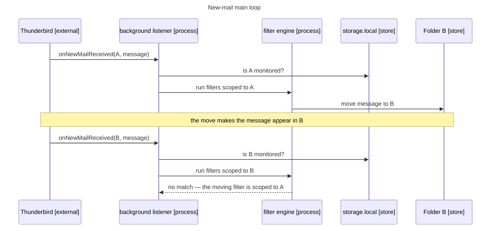

# Architecture

The extension is a Thunderbird MailExtension with no server and no build step. Three scripts run
in the extension context: `background.js` (the new-mail listener), `filter-engine.js` (pure
evaluation and actions), and `options.js` (the editor UI). `filter-engine.js` is shared between
the background page and the options page and is DOM-free so the test suite can load it in Node.

## New-mail main loop

Automatic filtering is event-driven. Thunderbird fires `messages.onNewMailReceived` whenever
messages *appear* in a folder — on genuine delivery **and** on moves (verified against real
Gmail and plain-IMAP accounts). The listener checks the folder against the global monitored list,
then runs only the filters scoped to that folder. Because a filter is scoped to its source
folder, the move it performs cannot match it again in the destination, which is what keeps the
loop from running forever.

**Figure.** A move re-fires the new-mail event in the destination, but source-folder scoping means
the same filter does not match there, so the message settles after a single move.
