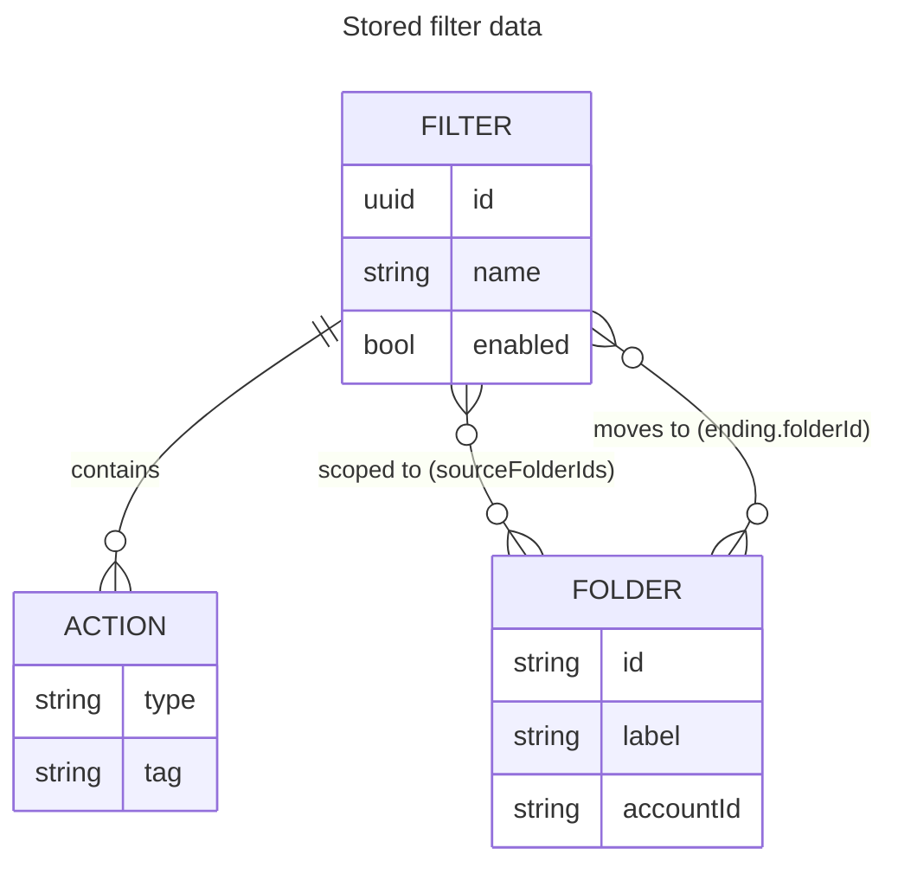
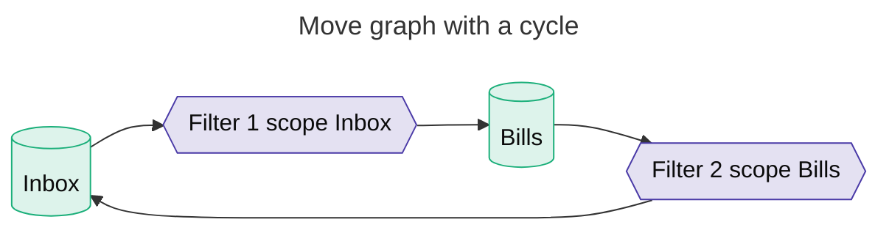

# Data model

Filters, folders, and the global monitored list are persisted in `storage.local`. A filter is
scoped to a subset of the monitored folders via `sourceFolderIds`; its `ending` (when a move)
points at a destination folder. The background page and the options page each load and
(idempotently) migrate this data on start.

## Stored filter data

**Figure.** A filter owns zero or more actions and one mutually-exclusive `ending`
(continue, move, or delete); a move ending references a destination folder by id.

## Move graph

A move ending draws an edge from each folder in its filter's source scope to its destination.
Save-time validation rejects any configuration whose move graph contains a cycle — that is the
one shape source-folder scoping alone cannot make idempotent.

**Figure.** Filter 1 (Inbox→Bills) and Filter 2 (Bills→Inbox) close a cycle; the save-time check
rejects the pair so a message cannot bounce between the two folders forever.
