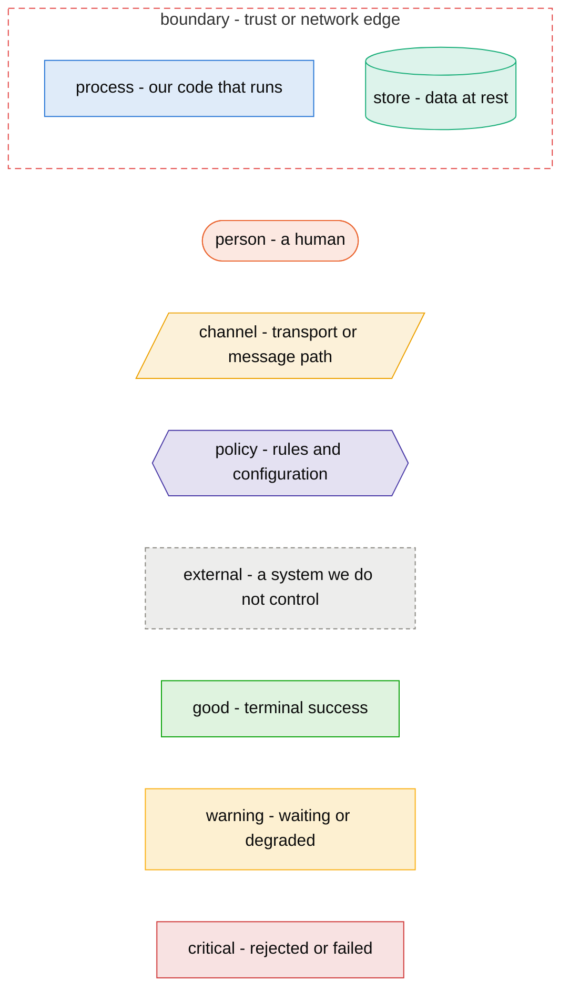

# Diagrams

This file is the single legend and inventory for every Mermaid diagram in this repo. Roles come
from one fixed palette; the same thing is the same color in every figure. Read the layer table
to know which kind of question each diagram answers.

## Layers

| Layer | Question it answers | Diagram types |
|---|---|---|
| UX/UI | What does a person see and do, in what order? | `journey`, `sequenceDiagram`, `stateDiagram-v2` |
| Data | What is stored, how is it shaped, how does a record change state? | `erDiagram`, `stateDiagram-v2`, `flowchart` |
| Infrastructure | What runs where, what talks to what? | `flowchart`, `sequenceDiagram` |
| Security/trust | Who may do what, where is the trust edge? | `flowchart` with `boundary` subgraphs |

One layer per figure. The red `boundary` subgraph appears only in security/trust figures.

## Legend

## Inventory

| Figure | File | Layer | Question it answers |
|---|---|---|---|
| New-mail main loop | `docs/architecture.md` | infrastructure | Why does a moved message not loop forever when it re-fires the new-mail event? |
| Stored filter data | `docs/data-model.md` | data | How do filters, folders, and actions relate in storage? |
| Move graph | `docs/data-model.md` | data | Where does a move cycle come from, and what does save-time detection reject? |

Dependency note: validation uses `scripts/check-diagrams.sh` from the `polimath-doc-diagrams`
skill. Rendering needs nothing; validation needs Node >= 18, `npx`, and a Chromium-family browser.
